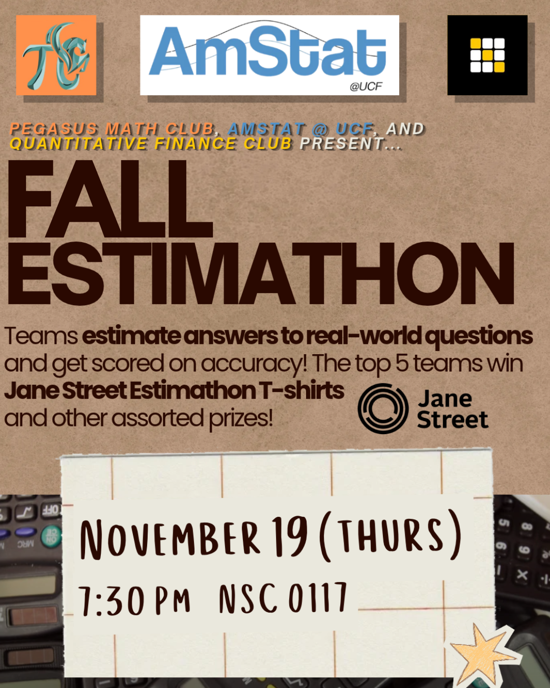

Presented by Pegasus Math Club, AmStat @ UCF, and the Quantitative Finance Club.

Teams estimate answers to real-world questions and are scored on accuracy. The
top five teams win Jane Street Estimathon T-shirts and other assorted prizes.

